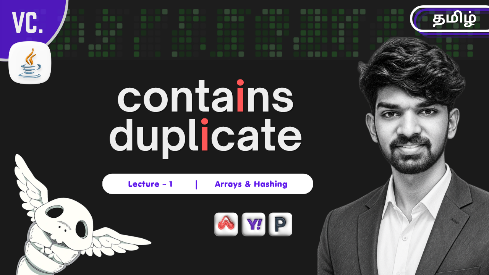

# Just DSA. 🚀

<div align="center">

  

  <br /><br />

  [](https://devkhishan.github.io/just-dsa/)
  [](https://devkhishan.github.io/just-dsa/)
  [](https://react.dev/)
  [](https://vitejs.dev/)
  [](https://oxc.rs/)

  <p align="center">
    <strong>A minimalist, problem-driven landing and curriculum exploration platform for the 8-Week Data Structures & Algorithms Masterclass.</strong>
  </p>

  <p align="center">
    <a href="https://devkhishan.github.io/just-dsa/"><strong>Explore Live Demo »</strong></a>
    ·
    <a href="https://www.youtube.com/@ventacode"><strong>Watch on YouTube »</strong></a>
    ·
    <a href="https://wa.me/918925124359"><strong>Enroll via WhatsApp »</strong></a>
  </p>

</div>

---

## 📖 Overview

**Just DSA** is a modern, high-performance web application designed for students and software engineers preparing for technical interviews at top-tier product companies (FAANG/MANG, Airbnb, PayPal, Yahoo, etc.).

Built with **React 19** and **Vite**, the application emphasizes a clean, distraction-free aesthetic — no fluff, just pure problem-driven learning. It showcases the complete 8-week curriculum breakdown, sample lecture walkthroughs, interactive curriculum exploration, and program enrollment logistics.

---

## ✨ Features

- 🌓 **Minimalist Dark & Light Modes**: 
  - Native dark mode by default with seamless toggle transitions.
  - Crafted with modern CSS custom variables and high-contrast typography using the [JetBrains Mono](https://fonts.google.com/specimen/JetBrains+Mono) typeface.
- 🎬 **Interactive Video Lecture Showcase**:
  - Embedded YouTube lecture carousel presenting core problem walkthroughs (such as *Contains Duplicate*, *Arrays & Hashing*).
  - Clean pagination controls with slide indicators.
- 🧭 **Phase-Based Curriculum Navigator**:
  - **Phase 1: DSA Fundamentals** — Full topic breakdown (Arrays, Hashing, Two Pointers, Sliding Window, Binary Search, Stack, Linked List, Recursion) with staggered entry animations.
  - **Phase 2: Advanced DSA** — Upcoming high-level topics (Trees, BSTs, Heaps, Greedy Algorithms, Graphs, Dynamic Programming) with an interactive lock state.
  - Smooth animated pill indicator reflecting phase selection.
- 💬 **Focus-Dimming Quote Showcase**:
  - Tweet-style card highlighting timeless advice (*"The best investment you can make is in yourself."* — Warren Buffett).
  - Background dimming overlay on hover for high-impact focus.
- 💳 **Interactive Investment & Course Details**:
  - Transparent pricing display (`₹2,999` for Phase 1).
  - Click-to-reveal accordion drawer disclosing duration (2 months / 40 classes), schedule (8 PM - 9 PM IST), holiday schedule, and lifetime recording access.
- 📲 **Instant Registration & Contact Channels**:
  - Direct 1-click WhatsApp enrollment redirection.
  - Direct links to YouTube ([@ventacode](https://www.youtube.com/@ventacode)), LinkedIn, and LeetCode.

---

## 🛠️ Tech Stack

| Category | Technology |
|---|---|
| **Frontend Framework** | [React 19](https://react.dev/) |
| **Bundler & Build Tool** | [Vite 8](https://vitejs.dev/) |
| **Styling** | Modern Vanilla CSS (CSS Variables, Flexbox, CSS Grid, JetBrains Mono) |
| **Linter** | [Oxlint](https://oxc.rs/) |
| **Icons & Media** | Inline SVGs & Custom Graphics |
| **CI / CD & Hosting** | [GitHub Actions](https://github.com/features/actions) → [GitHub Pages](https://pages.github.com/) |

---

## 📂 Project Structure

```text
just-dsa/
├── .github/
│   └── workflows/
│       └── deploy.yml          # Automated GitHub Pages CI/CD workflow
├── public/
│   ├── favicon.svg             # Vector site favicon
│   ├── favicon.png             # Raster favicon
│   └── icons.svg               # SVG sprite definitions
├── src/
│   ├── assets/
│   │   ├── thumbnail.png       # Course video & README thumbnail
│   │   ├── hero.png            # Hero visual artwork
│   │   ├── leetcode.png        # LeetCode brand badge
│   │   └── warren_buffett.png  # Quote avatar image
│   ├── components/
│   │   ├── LandingPage.jsx     # Main landing page view and interactive sections
│   │   └── ThemeToggle.jsx     # Light/Dark mode switch component
│   ├── data/
│   │   └── syllabus.js         # Course syllabus & phase topic definitions
│   ├── App.css                 # Application-specific layouts
│   ├── App.jsx                 # Root component handling theme state
│   ├── index.css               # Global design tokens, typography & animations
│   └── main.jsx                # React DOM entry point
├── index.html                  # HTML entry template
├── package.json                # Project dependencies and npm scripts
├── vite.config.js              # Vite bundler configuration (base path: /just-dsa/)
└── README.md                   # Project documentation
```

---

## 🚀 Getting Started

Follow these steps to run the application locally on your machine.

### Prerequisites

- [Node.js](https://nodejs.org/) (version `20.x` or higher recommended)
- `npm` (bundled with Node.js)

### Installation

1. **Clone the repository**:
   ```bash
   git clone https://github.com/devkhishan/just-dsa.git
   cd just-dsa
   ```

2. **Install dependencies**:
   ```bash
   npm install
   ```

3. **Start the local development server**:
   ```bash
   npm run dev
   ```

4. **Open in browser**:
   Navigate to the local address displayed in your terminal (typically `http://localhost:5173/just-dsa/`).

---

## 📜 Available Scripts

In the project directory, you can run:

| Command | Description |
|---|---|
| `npm run dev` | Runs the app in development mode with Hot Module Replacement (HMR). |
| `npm run build` | Compiles and bundles production-ready assets into the `dist/` directory. |
| `npm run preview` | Locally serves the production build from `dist/` to verify bundling. |
| `npm run lint` | Runs [Oxlint](https://oxc.rs/) to check code quality and catch syntax issues. |

---

## 🚢 Deployment

The project is configured for automated continuous deployment using **GitHub Actions**.

- Every push to the `main` branch triggers the [deploy.yml](.github/workflows/deploy.yml) workflow.
- Node.js 20 builds the application with `npm run build`.
- The compiled bundle in `dist/` is automatically deployed to **GitHub Pages**:
  👉 **[https://devkhishan.github.io/just-dsa/](https://devkhishan.github.io/just-dsa/)**

---

## 📚 Curriculum Breakdown

### Phase 1: DSA Fundamentals (Included in Initial Access)
1. Arrays & Hashing
2. Two Pointers
3. Sliding Window
4. Binary Search
5. Stack
6. Linked List
7. Recursion

### Phase 2: Advanced DSA
1. Recursion & Backtracking
2. Binary Trees & Binary Search Trees
3. Heaps & Priority Queues
4. Greedy Algorithms
5. Graphs (BFS & DFS)
6. Dynamic Programming Fundamentals

---

## 👨‍💻 Instructor & Connect

Created and taught by **Dev Khishan**.

- 📺 **YouTube**: [@ventacode](https://www.youtube.com/@ventacode)
- 💼 **LinkedIn**: [devkhishan](https://linkedin.com/in/devkhishan)
- 🧩 **LeetCode**: [devkhishan](https://leetcode.com/u/devkhishan/)

- ✉️ **Email**: [devkhishan14@icloud.com](mailto:devkhishan14@icloud.com)

---

## 📄 License

This project is licensed under the MIT License -2 feel free to explore, learn, and build upon it!
